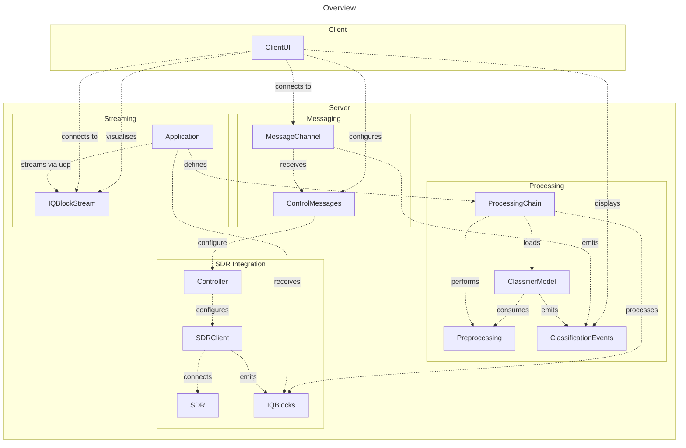
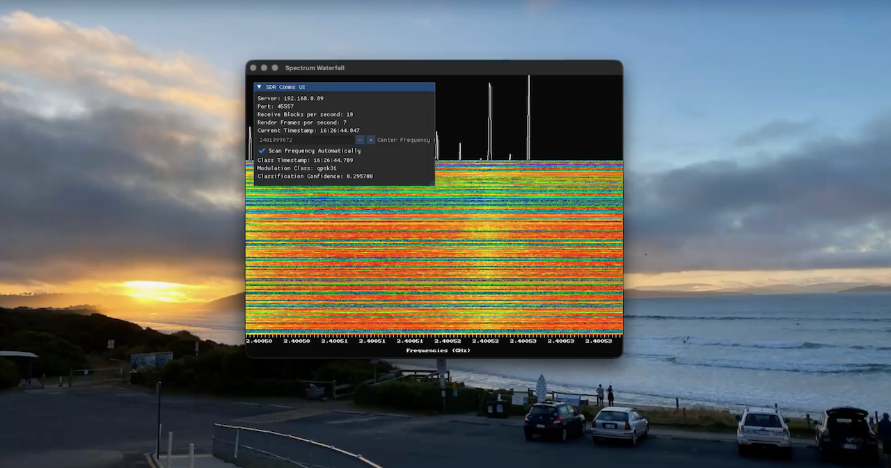

# sdr-comms - a project for SDR experimentation with application to modulation classification tasks

This project provides a shell for experimenting with the integration of modulation classification models that have been exported in [ONNX](https://onnx.ai) format in a research setting.

**This project explicitly does not deal with the development of modulation classifier models themselves. Experiments for that purpose will be provided in a separate repository.**

This project looks at integration of such models within a wider system incorporating SDR, control, network and client layers. 

This project is licensed under the [Creative Commons Attribution-NonCommercial-ShareAlike 4.0 International License](https://creativecommons.org/licenses/by-nc-sa/4.0/) 


To cite this project use the following:

```
@misc{site_key,
  author       = {{Chris Davey}},
  title        = {sdr-comms - a project for SDR integration for modulation classification tasks},
  year         = {2026},
  howpublished = {\url{https://github.com/cxd/cxd-sdrcomms}},
  note         = {Accessed: YYYY-MM-dd}
}
```

where ```YYYY-MM-dd``` is the date of access.

## Why Modulation Classification?

Modulation Classification acts as part of an overall suite of tools in the application of "spectral awareness", which is a subset of "situational awareness" applications. 

In particular, as the use of autonomous vehicles such as drones, or wheeled platforms becomes increasingly common. It becomes important to detect their presence from a distance, this may be achieved through a combination of modulation classification and radio frequency fingerprinting. Similarly, activities in various fields rely on use of the spectrum for data transmission. This may be paired with geolocation, and deployed on vehicular platforms or fixed structures. Such an application when paired with visual sensing and other sensing apparatus can be used to generate a localised map of physical terrain. Spectrum use becomes an overlay in that map.

However, there are significant challenges (not addressed in this project), which provide opportunities for investigation such as:

- RF sensing from a moving platform suffers from distortions such as doppler effect, how do we compensate for this in the downstream tasks?
- Channel environments change with changing terrain, how would channel estimation help downstream tasks?
- The decision to actually run the classifier on incoming IQ Values must make a decision "is this noise? or might it contain a signal?". What are the best ways to make this decision in a blind signal setting?
- The available spectrum is a large space, meaning there is opportunity to explore search methods, and coordination of multiple collaborating actors scanning the environment.

Companion tasks also include RF fingerprinting, which aims to identify the nature of the device, or at least transmitter that is detected. This differs from modulation classification, but provides both data enrichment and potential for physical layer security in upstream tasks.

This is a rich area of potential research, with many related problems to explore.

## Why a Focus on Integration?

Many research articles focus primarily on the development of the model itself, and perhaps preprocessing. However integration of the model into a larger system is often overlooked. This is a non-trivial task, and one that provides an opportunity to investigate the practical challenges. 

This project provides a shell for the exploring the integration challenges.

Overall the integration has been an exercise working out how to combine all of the pieces that would comprise a blind modulation classification system as well as testing on multiple platforms including raspberry pi (if anyone wants to supply a jetson nano, this would also be a target of interest).

The following points are areas where the current integration has focused on:

- use of SDR device to capture IQ values and perform frequency scanning
- integration with preprocessing such as resampling IQ signal and FFT using hardware acceleration (vkFFT, and liquid-dsp libraries).
- integration with ONNX runtime to execute machine learning models
- network integration for remote control of the scanning operations (stop/start auto scanning, set frequency)
- network integration for streaming IQ values over UDP in custom streaming protocol
- network integration for messaging using MQTT for control and classification events
- management of multiple processing queues for receiving streams from SDR, processing, model classification and network communications,
- testing cross compilation against arm64 for raspberry pi targets.

## High Level Architecture

The server application is divided into four main areas of concern.

- SDR Integration
  - Is responsible for configuration of the SDR device. In this case we use the SoapySDR interface supporting remote or local devices.
  - Control component is also responsible for implementing the simple automatic scanning process. However, in a more advanced system the search algorithm could become a fifth area of concern. 
- Streaming
  - Streaming consumes the IQBlocks emitted by the SDR and supports sending to multiple client endpoints in a custom chunking protocol over UDP.
- Processing
  - The Processing component assembles a processing chain that may perform a series of transformations or alternately take various measurements from the incoming IQ data. The processing chain is also responsible for integration with the classification model.
- Messaging
  - Within the process data is exchanged over queues. 
  - Externally, the system leverages a separate Mosquitto server to enable publication to topics. MQTT was chosen as it is a common mechanism in IoT and has low overhead for integration.
  - Messaging over MQTT via tcp consumed by the client.

The application layer leverages the core library with some application specific components to assemble the base functionality of the server. This is defined in the ```application``` source directory. 
The common library is defined in the ```client``` source directory.

To display outputs from the server and interact with the basic configuration of the controller, a client UI is defined to display a IQ time/frequency waterfall of received IQ data and the most recent frequency spectrum. 
It also leverages an inset panel to display information for latest received timestamps, to allow the user to configure automatic scanning or manual scanning and to enter a center frequency in Hz. The client components are defined in the ```sdrcommsui``` source directory.

A conceptual overview of the system is described in the diagram below.



## Example Client UI

This project includes an example client UI which receives IQ Value streams over UDP and the classification events over MQTT on the TCP port. It provides an example waterfall visualisation for the IQ Value stream, the current frequency graph (both in SDL), and a small control interface (in ImGui), to allow viewing current data rates, controlling whether to automatically scan or to manually set the center frequency.

An example is shown below.



https://github.com/cxd/cxd-sdrcomms/raw/refs/heads/main/docs/assets/screen_recording_001.mp4?sanitize=true


Typically the client may connect intermittently over a WiFi connection to the server (as in the case when the SDR and server are deployed on a mobile platform such as a drone). The wifi connection will be challenged to deliver the UDP stream at a large distance. As the stream can mean gigabytes of data transfer over a duration of time. However, classification events are small packets. When on board an autonomous platform, the IQ Value stream may not be used at all, instead classification events may be sent over MQTT locally to another controller process that is onboard the platform. The event paired with other sensor data may then be repackaged and issued to a connected control system downstream. 

# Dependencies

In my environment, I'm working on macOS, Ubuntu 26.04 LTS and Raspberry Pi OS with a PlutoSDR so my initial dependencies are: 

Requires installed libraries

```aiignore
sudo apt install libiio libiio-dev libad9361-0 libad9361-dev
```

Above that I'm using the excellent library [SoapySDR](https://github.com/pothosware/SoapySDR).

I use both local SDR connection as well as experimenting with the soapy remote server.
However, this project builds the soapysdr library along with soapyremote and the soapypluto module using FetchContent in cmake. 

However the packages on linux are avalable using:

```
sudo apt install soapyremote-server soapysdr-tools
```

Additional dependencies built with FetchContent include:

- [vkFFT](https://github.com/DTolm/VkFFT) 
- [nlohmann/json](https://github.com/nlohmann/json)
- [ImGui](https://github.com/ocornut/imgui)
- [CLI11](https://github.com/CLIUtils/CLI11.git)


and on macOS

- [SDL2](https://github.com/libsdl-org/SDL)

A local thirdparty directory clones the submodule:
[SDL2_gfx](https://github.com/giroletm/SDL2_gfx)

## List of apt dependencies on Ubuntu and Debian

```
libsdl2-dev \
libboost-program-options-dev \
libsamplerate0-dev \
# Bare-metal display driver dependencies for KMS/DRM
libdrm-dev \
libgbm-dev \
# Embedded mobile GPU rendering layers for Mali chips
libgles2-mesa-dev \
libegl1-mesa-dev \
# SDR integration
libusb-dev \
libiio0 \
libiio-dev \
libiio-utils \
libad9361-0 \
libad9361-dev \
libavahi-core-dev \
libvulkan-dev \
vulkan-tools \
glslang-dev \
glslang-tools \
glslc \
mosquitto-dev libmosquitto-dev \
libonnxruntime-dev \
libliquid-dev \
libfftw3-dev \
```

On Debian Trixie the onnx providers are distributed as part of the onnxruntime. However on Ubuntu 26.04 LTS a separate package is needed.
```
libonnxruntime-providers \
```


### Pluto SDR Links
[PlutoSDR](https://wiki.analog.com/university/tools/pluto) is manufactured by [Analog Devices](https://github.com/analogdevicesinc)

### Raspberry Pi Dependencies

The script in docs/notes/raspberrypi_dependencies.sh provides a set of dependencies that can be deployed for runtime on the raspberry pi.

```
#!/bin/bash

# dependencies for raspberry pi 6.18.50+rpt-rpi-2712 #1 SMP PREEMPT Debian 1:6.18.50-1+rpt1 (2026-09-11) aarch64 GNU/Linux
sudo apt update
sudo apt install -y libsdl2-dev libsdl2-image-dev libsdl2-mixer-dev libsdl2-ttf-dev
sudo apt install libiio-dev libiio-utils libad9361-dev libad9361-0 iiod libiio0
sudo apt install libvulkan-dev vulkan-tools
sudo apt install glslang-dev glslang-tools glslc
sudo apt install libonnxruntime-dev -y
sudo apt install onnxruntime-tools libarmnnaclcommon33t64 libarmnn33t64 libarmnn-gpuacc-backend33 libarmnn-cpuacc-backend33 libarmnn-cpuref-backend33
sudo apt-get install -y libvulkan-dev vulkan-tools glslang-dev glslang-tools glslc mosquitto-dev libmosquitto-dev libonnxruntime-dev libliquid-dev libfftw3-dev
```

### Building

On linux and macOS the build can be performed with cmake.

```
cmake -B cmake-build-debug
cmake --build cmake-build-debug --target all -j 8
```

On linux if using clang there is an optional build script:

```
#!/bin/bash

rm -rf build_clang_amd64
cmake -B build_clang_amd64 \
-DCMAKE_TOOLCHAIN_FILE=clang_linux_amd64.toolchain.cmake \
-DBoost_DIR=/usr/lib/x86_64-linux-gnu/cmake/Boost-1.83.0
cmake --build build_clang_amd64

```

## Building for arm64

I found it convenient to use a docker image to build for arm64 from a x86_64 linux host.
This requires that the ```qemu-user-binfmt``` are installed on the host.

The docker file is provided in ```Containerfile.arm64``` and the script:

```
build_clang_arm64.sh
```

Executes the build using ```podman``` the resulting build directory is ```build_emulated_arm64```.

Artifacts for arm64 can be copied into a build directory along with an install script for raspberry pi using the ```distro_arm.sh``` script.

Once copied into the home directory on the raspberry pi target, they can be installed with the ```build/arm64/install_arm.sh``` script.

### Systemd services configuration


There are three main systemd units in the ```service/services``` directory.

- mosquitto.service
  - uses a custom configuration to be copied below ```/etc/mosquitto/conf.d``` from the same directory.
  - copy the mosquitto.service file into /etc/systemd/system and enable the service unit.
  ```
  sudo systemctl daemon-reload
  sudo systemctl enable mosquitto.service
  ```
  
- soapyremote-custom.service
  - Assumes soapysdr server is installed in ```/usr/local/bin``` and loadable modules in ```/usr/local/lib/SoapySDR/modules/```
- soapyremote-custom-arm.service
  - assumes that the bundled soapy sdr server is deployed with the ```install_arm.sh``` script.

### ONNX Classification Model File

Classification models are developed in an external project. However the default model for testing is ```mod_dualbranch_tcn``` located in the ```resources``` folder of the project.

Configuration files are used to define:

- resources/class_map_v1.json
  - the list of supported classes
- resources/mod_dualbranch_tcn.json
  - the model configuration and required parameters and preprocessing.

For initial integration testing the default model will do. The configuration for this model is as follows:

```
{
  "name": "mod_dualbranch_tcn",
  "version": "001B_export",
  "class_map_version": 1,
  "onnx_file": "mod_dualbranch_tcn/001B_export/2026-10-25/model.onnx",
  "sample_rate_hz": 6000,
  "input_length": 2048,
  "logits": true,
  "input_transforms": ["downsample", "fft"]
}
```

The above defines the path where the onnx file is found and configuration of the model based on the data it was trained on (from https://panoradio-sdr.de/radio-signal-classification-dataset/)

This model was a coarse resolution model using training data sampled at only 6kHz with an input length of 2048 IQ samples. The model uses logits in its classification head, so probabilities are calculated by the application instead of the model.
It uses two input transforms which are first a downsample transform and second an fft transform which operates on the downsampled data.

Those inputs are then converted into a tensor of shape [1 x 4 x 2048] where the real and imaginary values of the downsampled IQ time domain and the FFT are each a single channel (the second dimension ).

Note also the model itself is not very accurate, it is provided only to test integration, a separate repository will be created to demonstrate how the data sets and models are prepared.


The ```class_map_v1.json``` file maps the indices of the [1 x num_classes] output. It is a simple mapping between class label and index position, and is used to translate between the index containing the maximum probability and the class label.

```
{
  "version": 1,
  "num_classes": 18,
  "classes": {
    "am": 0,
    "dominoex11": 1,
    "fax": 2,
    "lsb": 3,
    "morse": 4,
    "mt63_1000": 5,
    "navtex": 6,
    "olivia16_1000": 7,
    "olivia16_500": 8,
    "olivia32_1000": 9,
    "olivia8_250": 10,
    "psk31": 11,
    "psk63": 12,
    "qpsk31": 13,
    "rtty100_850": 14,
    "rtty45_170": 15,
    "rtty50_170": 16,
    "usb": 17
  }
}
```


### Running the application

On macOS a script to start mosquitto server for testing is provided in ```run_mosquitto_macos.sh```

On raspberry pi the run script for the application is located in ```/opt/sdrcomms/bin/run_application_arm.sh```

```
#!/bin/bash

export SOAPY_SDR_PLUGIN_PATH=/opt/sdrcomms/lib/modules/
export SOAPY_LIB=/opt/sdrcomms/lib
export LD_LIBRARY_PATH=$SOAPY_LIB:$SOAPY_SDR_PLUGIN_PATH:$LD_LIBRARY_PATH
./application --server-uri=tcp://127.0.0.1:11111 \
              --driver-name=remote \
              --remote-driver=plutosdr \
              --device-uri=ip:pluto.local \
              --bind-address=127.0.0.1 \
              --udp-server-address=0.0.0.0 \
              --model-path=/opt/sdrcomms/resources \
              --model-file=/opt/sdrcomms/resources/mod_dualbranch_tcn.json \
              --class-map-file=/opt/sdrcomms/resources/class_map_v1.json

```

The application connects to a local soapysdr-remote server instance on port 1111. It passes through the bind address to soapysdr-remote. To export the UDP streaming server it listens on all interfaces 0.0.0.0 and uses port 45557 by default and will assume a local connection to mosquitto server on the localhost and default port 1883.

### Running in macOS

SoapySDR server was not used on macOS instead the soapy plut module was loaded directly from the soapysdr parameters. 

### Running the sdrcommsui

The sdrcommsui will connect to an already running instance of the application. It can be started with parameters for the server and port to connect to.

```
./sdrcommsui \
--server-address \
192.168.0.89 \
--udp-stream-port \
45557
```

### Contributing ###

I joke that in the age of AI, people will only write source code for the same reason they whittle wooden spoons. In this project, the extent of AI has been in searching or asking the google agent for examples of how to use unfamiliar APIs. Other that, there has been use of reference websites, and even occasional use of those ancient papery things known as "books". 


Human Handprint by _RootOfAllLight, CC BY-SA 4.0, via Wikimedia Commons_

For this project, if you'd like to contribute it'd be nice to avoid any kind of agent workflow for the time being. There's nothing stopping you doing it in your own copy of the repo.

However, there is plenty of work to explore in this area of application as mentioned earlier in this README. 